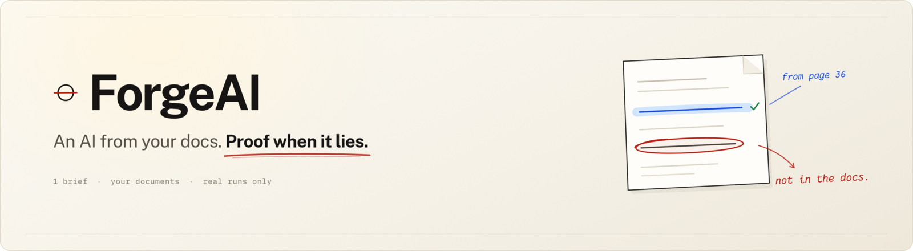
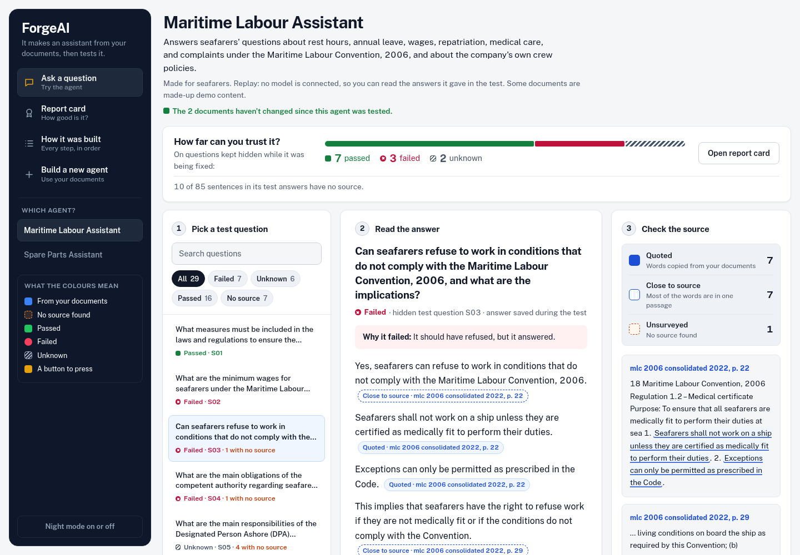
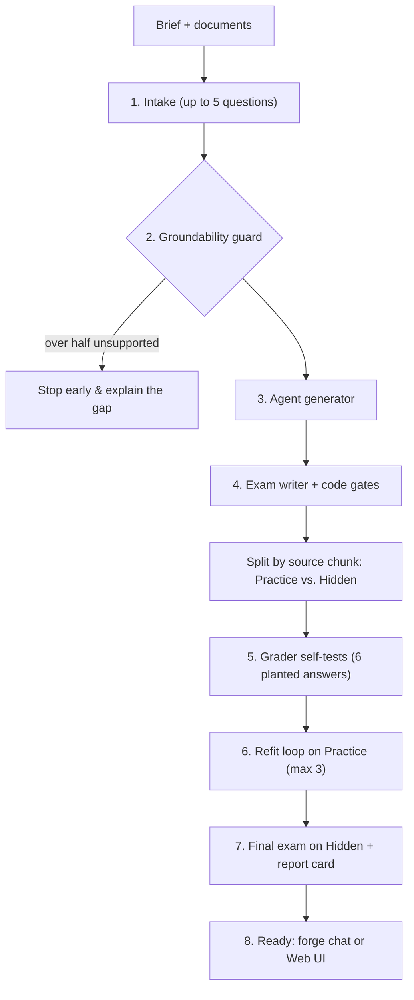
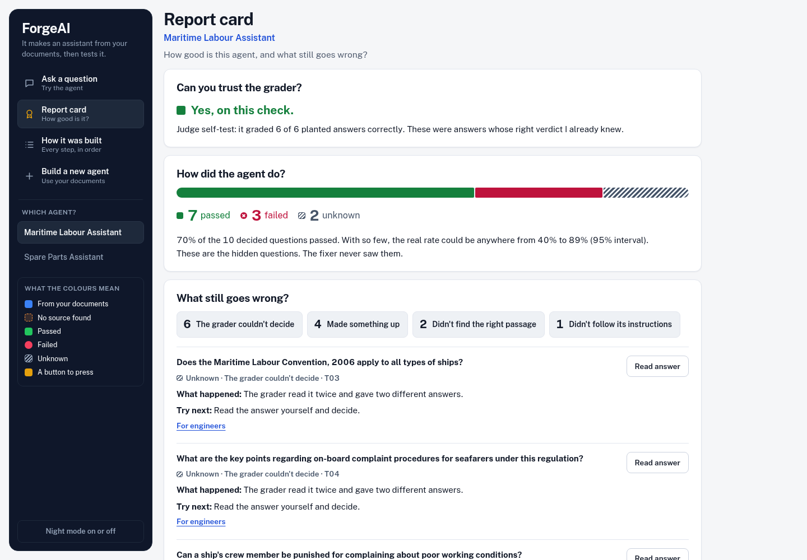
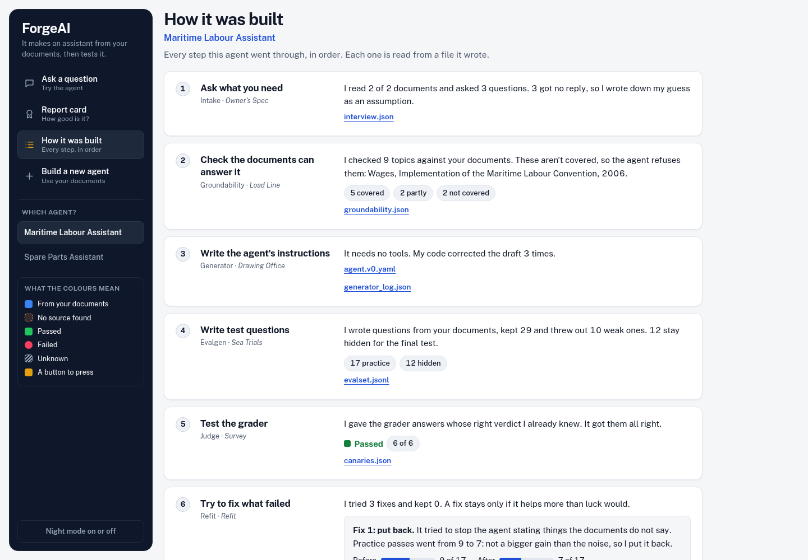

# ForgeAI

Anyone can wire a chatbot to a folder of PDFs in an afternoon. Almost nobody can tell you whether it will hold up when a real person acts on its answer.

Picture a seafarer at midnight checking a 120-page maritime convention to see if they can refuse unsafe work. Or a superintendent scanning a 300-row parts sheet before the next port call. You ask an AI, and 2 seconds later it hands you a fluent, confident answer. You have no idea if it read the document or invented the rule.

Ask a second AI to grade the first one, and you still don't know. Small models miss planted lies, reward long answers, and go easy on their own model family.

ForgeAI is built to end that guesswork. You give it 1 paragraph and your documents. It builds a document-grounded agent, writes an exam from your own pages, seals part of that exam away, tests the grader with planted lies before trusting a single score, tries up to 3 controlled fixes, and hands you the working agent beside a plain report card of everything that still fails.

<!-- SCREENSHOT: Main Web UI, Ask a question (1440x900) -->


## See it work in 60 seconds

No API key and no model needed. Both finished runs are committed in this repo, and the web UI replays every recorded answer with its exact source passage highlighted.

Requires Python 3.11+ and [uv](https://docs.astral.sh/uv/).

```bash
uv sync --extra ui
uv run forge ui
```

Open the local URL, pick an agent on the left, click any test question, and check the highlighted passage on the right. Every number on the screen comes straight from the files the run wrote.

To build an agent from your own brief and documents:

```bash
cp .env.example .env
uv run forge doctor --config forge.colab.toml
uv run forge build --brief path/to/brief.txt --docs path/to/docs --unattended --config forge.colab.toml
uv run forge chat runs/<run-id>/agent.final.yaml --config forge.colab.toml
```

Pass `--config` to `forge ui` to ask live questions and launch new builds from the browser:

```bash
uv run forge ui --config forge.toml
```

## How it works

Every stage runs on a small open model, so every stage assumes the previous one could be wrong. Code settles everything code can settle. The model only gets the part code can't decide.



Five rules keep the pipeline honest:

1. **Two different model families.** The builder writes and runs the agent. The examiner writes the exam and grades it. Neither grades its own family.
2. **Code checks first.** Output format, citations, exact quotes, and required tool calls are verified in Python before the grader reads a word. The model can't overturn a code failure.
3. **The grader takes its own exam first.** Every run feeds 6 planted answers to the grader (correct answer, swapped number, padded answer, added false claim, shuffled evidence, correct refusal). If it misses even 1, every model-dependent verdict becomes `unknown`.
4. **Two blind passes.** The grader scores every answer twice with the evidence in opposite orders. If the 2 passes disagree, the verdict is `unknown`.
5. **Sealed final exam and noise floor.** Questions are split by source chunk so 1 paragraph never appears in both Practice and Hidden. The fixer never sees Hidden. A fix stays only if its gain beats the run's measured flip noise.

## Results from 2 real runs

Both runs executed on a Tesla T4 using Llama 3.1 8B (builder) and Qwen 2.5 7B (examiner) through Ollama.

| | [Maritime Crew Rights (MLC)](runs/mlc-crew-rights/report.md) | [Spares Procurement](runs/spares-procurement/report.md) |
|---|---|---|
| Documents | ILO MLC 2006 (120 pages) + synthetic crew handbook | 300-row synthetic catalogue + 3 supplier terms + 1 policy |
| Tools attached | None (3 proposed, all dropped by code) | `csv_lookup`, `calculator` |
| Test questions kept | 29 of 39 generated | 29 of 35 generated |
| Grader self-tests | 6 of 6 passed | **5 of 6** (missed 1 planted lie) |
| Hidden exam | **7 passed, 3 failed, 2 unknown** | **No usable score** (0 passed, 2 failed, 8 unknown) |
| Practice exam | 9 passed, 4 failed, 4 unknown | 0 passed, 2 failed, 17 unknown |
| Fixes kept | 0 of 3 | 0 of 3 (1 broke a patch rule and never ran) |
| Calls / tokens | 336 / 827,485 | 282 / 410,583 |

**Why MLC's 70% has a wide bar.** 7 of the 10 decided hidden cases passed. With 10 cases, the 95% confidence interval is 40% to 89%. The report prints that range instead of pretending 70% is exact.

**Why Spares has no score.** On the grader self-test, the examiner caught the true claim and missed a planted lie (*"Written approval from the regional supervisor is also required"*). ForgeAI threw out every model-dependent verdict and marked them `unknown`. Only code-decided failures stayed. I left the run as it fell.

**What still fails:**
- MLC (hidden): answered 2 questions it should have refused (`S02`, `S03`), missed 2 key facts (`S04`), and split the 2 grader passes (`S05`, `S06`).
- Spares: never called `csv_lookup` or `calculator` despite its prompt rules, and answered *"Can we get this part from another supplier?"* instead of refusing.

**Known faults:**
- Groundability falsely demoted MLC *Wages* despite Regulation 2.2 (driving `S02`).
- A planted annual-leave conflict between the handbook and MLC went untested.
- Thin edge cases: 1 ambiguous and 1 cross-document case in MLC; 1 ambiguous and 0 cross-document in Spares.
- Prompt leak in Spares (*"unless another member has reserved them"*).
- Both report writers typed numbers against their rules, so both fell back to the code-filled template.

Every pipeline lie I caught during development lives in [WHERE_FORGEAI_LIED.md](WHERE_FORGEAI_LIED.md).

## Inside the Web UI

The UI reads directly from each run folder. Starting a build spawns `forge build --unattended` in the background, so closing the tab never stops a run.

- **Ask a question:** Agent summary, trust bar, and 3 columns: pick a test question, read the answer with code-marked sentences (*Quoted*, *Close to source*, *Unsurveyed*), and check the highlighted passage.
- **Report card:** Grader trustworthiness, hidden-exam bar, plain-English failure list, clickable question grid, and standalone HTML **Download certificate**.
- **How it was built:** All 8 stages in order with the files each wrote.
- **Build a new agent:** 1 paragraph, your documents, 1 button.
- **Local by default:** Analytics off, fonts shipped locally in [forge/fonts/](forge/fonts/), and `--config` bound to `127.0.0.1`.

<!-- SCREENSHOT: Report card page -->


<!-- SCREENSHOT: How it was built page -->


## Model setups and Colab

Any OpenAI-compatible endpoint works. Free tiers may train on your data, so use public or synthetic documents there.

| Config | Builder + Examiner | Needs | Measured |
|---|---|---|---|
| `forge.colab.toml` | Llama 3.1 8B + Qwen 2.5 7B (Ollama) | GPU ([colab/forge_colab.ipynb](colab/forge_colab.ipynb)) | Both committed runs; MLC finished in under 1 hour on a T4 |
| `forge.toml` (default) | Ministral 8B + Gemma 4 26B | 2 free API keys | Rate-limited (2 RPM, 16k TPM); takes hours |
| `forge.openrouter.toml` | Llama 3.1 8B + Qwen 8B | OpenRouter credit | Partial runs before credit ran out |

Run an unseen brief on Colab: build the zip with `python colab/make_zip.py`, open [colab/forge_colab.ipynb](colab/forge_colab.ipynb), pick a GPU, and click **Run all**. Setup takes about 10 minutes.

Replay a committed run offline with 0 model calls:

```bash
cp -r runs/mlc-crew-rights /tmp/mlc-replay
uv run forge resume /tmp/mlc-replay --replay --config forge.colab.toml
```

## Reference for engineers

<details>
<summary>CLI flags, exit codes, and supported files</summary>

| Flag | Meaning |
|---|---|
| `--unattended` | No prompts; intake defaults recorded as assumptions |
| `--answers answers.yaml` | Supply intake answers upfront |
| `--max-refits N` | 0 to 3 |
| `--budget-tokens N` | Stop early and still write the report |
| `--replay` | Serve calls strictly from `llm_calls.jsonl` cache |

Exit codes: `0` built and reported, `1` user error, `2` no readable docs or ungroundable brief, `3` token budget or credit exhausted (partial report written), `4` stage crashed (`forge resume runs/<id>` reuses finished calls).

Inputs: text-layer PDF, DOCX, CSV, Markdown, plain text. Scanned PDFs are skipped (no OCR).

</details>

<details>
<summary>Pipeline stages, tools, tests, and repo layout</summary>

1. [forge/intake.py](forge/intake.py): folder inventory + up to 5 grounded questions.
2. [forge/groundability.py](forge/groundability.py): quote-verified topic support; halts if over half unsupported.
3. [forge/generator.py](forge/generator.py): 9 prompt sections + tool pruning + output contract enforcement.
4. [forge/evalgen.py](forge/evalgen.py), [forge/gates.py](forge/gates.py): case generation + deterministic rejection gates (`evalset.rejected.jsonl`).
5. [forge/judge.py](forge/judge.py), [forge/checks.py](forge/checks.py): code checks, dual blind passes, numeric guard, 6 canaries.
6. [forge/loop.py](forge/loop.py), [forge/classify.py](forge/classify.py): failure clustering + constrained patches (max 3 ops, 60 added words, no train 4-gram copying) gated by flip noise.
7. [forge/report.py](forge/report.py): separate passed/failed/unknown counts, 95% CIs, forced warnings.
8. [forge/chat.py](forge/chat.py): same `run_turn()` path as evals; checks document SHA-256 hashes unless `--reindex` is passed.

**Tools:** `csv_lookup` (filter/sort CSVs), `calculator` (safe arithmetic), `date` (relative dates), `marine_weather` (keyless Open-Meteo marine forecast).

```bash
uv run pytest --deselect tests/test_tool_selection.py   # offline suite
uv run pytest tests/test_tool_selection.py               # live tool selection (needs keys)
```

```text
forge/              pipeline, judge, refit loop, chat, web UI (ui.py, views.py, ui.css, jobs.py), tools
prompts/            all factory prompts
briefs/             the 2 demo briefs
data/               demo documents and synthesis scripts
runs/               the 2 committed runs (replayed offline to keep only live-read calls)
colab/              GPU notebook and zip builder
judge_calibration/  20-case human calibration sheet (calibrate.py)
tests/              test suite
```

</details>

## Limits and what's not built yet

- **No hand-labelled judge calibration yet.** This is my first LLM judge, and self-tests are its only check so far. [judge_calibration/sheet.md](judge_calibration/sheet.md) holds 20 cases ready to score via `uv run python judge_calibration/calibrate.py score`.
- **Source marks show where the words came from.** A *Quoted* or *Close to source* sentence can still misread a passage, and a sentence combining 2 passages can show as *Unsurveyed*.
- **Overfitting to 2 demos.** Several guardrails came from watching MLC and Spares fail. An unseen brief will surface faults these 2 didn't.
- **Not built:** cross-document contradiction detection, multi-turn evaluation, OCR for scanned PDFs, non-Linux Stop/Resume (reads `/proc`), or multi-user hosting.
