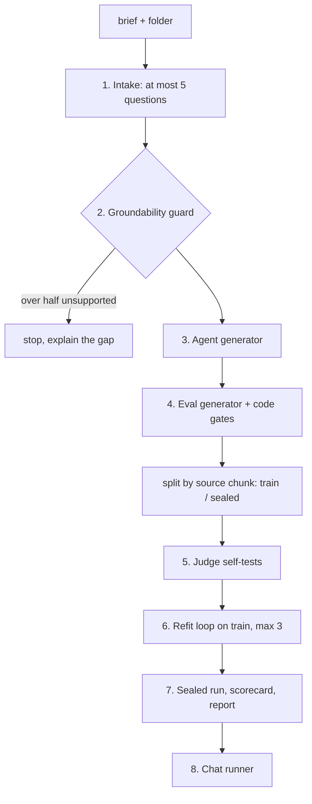

# ForgeAI

ForgeAI builds a document-grounded agent from one paragraph, tests it with questions it writes itself, and reports what still fails and why.

> An agent has no light of its own. It only reflects what it was given. ForgeAI is how I check what it was given.

You give it a brief and a folder of documents. It returns an agent definition (system prompt, retrieval settings, tools, output contract), a generated eval set, an iteration log, a scorecard and a report. Every stage runs on a small open model, so the pipeline assumes each of them can be wrong.

## Results of the two committed runs

Both ran on a Tesla T4 with Llama 3.1 8B (builder) and Qwen 2.5 7B (examiner) through Ollama.

| | [Crew rights (MLC)](runs/mlc-crew-rights/report.md) | [Spares procurement](runs/spares-procurement/report.md) |
|---|---|---|
| Documents | MLC 2006 (ILO, 120 pages) and a synthetic crew handbook | Synthetic catalogue (300 rows), three supplier terms, one policy |
| Tools attached | none | `csv_lookup`, `calculator` |
| Eval cases kept / generated | 29 / 39 | 29 / 35 |
| Judge self-tests passed | 6 of 6 | **5 of 6** |
| Sealed set | **7 passed, 3 failed, 2 unknown** | **No usable score:** 0 passed, 2 failed, 8 unknown |
| Train set | 9 passed, 4 failed, 4 unknown | 0 passed, 2 failed, 17 unknown |
| Refits accepted | 0 of 3 | 0 of 3 (one broke a patch rule and never ran) |
| Model calls / tokens | 336 / 827,485 | 282 / 410,583 |

**How to read this.** "70%" in the MLC report is 7 of the 10 cases the judge could decide. With 10 decided cases, the 95% interval is 40% to 89%. The agent is not shown to be better than that.

**Why spares has no score.** On every run the judge grades planted answers with known verdicts. Here it listed the true claim and skipped a made-up one ("Written approval from the regional supervisor is also required"). ForgeAI then marked every verdict that depends on the model as unknown. Only verdicts decided by code remain. I left the run as it is.

### What still fails

MLC, sealed set:

- **S02, S03:** answered questions it should have refused.
- **S04:** missed two key facts that were needed.
- **S05, S06:** the two judge passes disagreed, so the verdict is unknown.

Spares:

- The agent **never called its tools**, although its rules say to use them. Cases that require a tool fail on that check.
- It answered "Can we get this part from another supplier?" when it should have refused.

All open cases are listed in each `report.md`.

### Weaknesses of these runs

- **A likely false demotion.** The groundability check marked MLC "Wages" as unsupported, although the Convention has Regulation 2.2, Wages. S02 is a "failure" partly because of this.
- **A planted conflict went untested.** The crew handbook states less annual leave than the Convention's minimum. No generated case required the agent to show both figures.
- **Thin edge cases.** MLC has one ambiguous and one cross-document case. Spares has one ambiguous case and no cross-document case.
- **A prompt example leaked.** The spares agent's prompt contains "unless another member has reserved them", copied from a library example in the factory's prompts.
- **No written analysis.** In both runs the report writer broke its rule against typing numbers, so both reports use the template filled by code.

## Where ForgeAI lied to me

[WHERE_FORGEAI_LIED.md](WHERE_FORGEAI_LIED.md) records each time the pipeline fooled me, how I caught it, and what stops it now. Examples:

- The interviewer invented part number `P12345`, and the groundability check then refused four valid topics.
- The judge graded a correct refusal as a made-up claim.
- The report writer stated that five of six self-tests had failed when five had passed.

## Quick start

Requires Python 3.11+ and [uv](https://docs.astral.sh/uv/).

```bash
uv sync
cp .env.example .env
uv run forge doctor --config forge.colab.toml
uv run forge build --brief path/to/brief.txt --docs path/to/docs --unattended --config forge.colab.toml
uv run forge chat runs/<run-id>/agent.final.yaml --config forge.colab.toml
```

Reproduce a committed run **without any model** (copy it first, because the run folder is rewritten):

```bash
cp -r runs/mlc-crew-rights /tmp/mlc-replay
uv run forge resume /tmp/mlc-replay --replay --config forge.colab.toml
```

### Model setups

| Config | Models | Needs | Measured |
|---|---|---|---|
| `forge.colab.toml` | Llama 3.1 8B + Qwen 2.5 7B on Ollama | A GPU. [colab/forge_colab.ipynb](colab/forge_colab.ipynb) sets it up | Used for both committed runs. The first full MLC run took under an hour on a T4 |
| `forge.toml` (default) | Ministral 8B (Mistral) + Gemma 4 26B (Google) | Two free API keys | Hours per run: 2 requests a minute and 16,000 input tokens a minute |
| `forge.openrouter.toml` | Llama 3.1 8B + Qwen 8B | Paid OpenRouter credit | Only partial runs: the credit ran out |

Any OpenAI-compatible endpoint works. Free tiers may train on what you send, so use public or synthetic documents with them.

To run an unseen brief on Colab: build the upload with `python colab/make_zip.py`, open the notebook, choose a GPU and **Run all**. At **New brief**, paste the brief and upload the documents. The notebook builds the agent, prints the report, downloads the run and lets you ask it a question. Setup takes about 10 minutes before the build starts.

### Flags and exit codes

| Flag | Meaning |
|---|---|
| `--unattended` | No prompts. Each intake default is recorded as an assumption |
| `--answers answers.yaml` | Supply intake answers in advance |
| `--max-refits N` | 0 to 3 |
| `--budget-tokens N` | Stop early and still write the report |
| `--replay` | Serve model calls from the run's cache only |

| Exit code | Meaning |
|---|---|
| 0 | Agent built and reported |
| 1 | User error |
| 2 | No readable documents, or the brief is not groundable |
| 3 | Budget spent or provider credit exhausted; partial report written |
| 4 | A stage crashed. `forge resume runs/<id>` reuses finished model calls |

Inputs: PDF with a text layer, DOCX, CSV, Markdown, text. Scanned PDFs are listed as not read. There is no OCR.

## Architecture



Each stage writes its files to `runs/<id>/` before the next starts. Every model call is logged in `llm_calls.jsonl` and cached by a hash of model, messages and parameters.

| Side | Stages |
|---|---|
| Builder | intake, agent generator, fixer, the agent itself |
| Examiner | groundability, eval generator, judge, failure diagnosis, report writer |

The two sides use different model families, so the judge does not grade its own family's writing. Retrieval is BM25 and MiniLM embeddings fused by weighted reciprocal rank.

## The nine requirements

1. **Intake interviewer** ([intake.py](forge/intake.py)). Reads the folder inventory, then asks at most 5 questions. A topic may need arithmetic only if the brief asks for computed answers. Code drops a question whose trigger is not in the brief or a file name. A default nobody confirmed may not refuse what the brief asks for; the documents decide.

2. **Groundability guard** ([groundability.py](forge/groundability.py)). Each topic is `supported`, `partial` or `unsupported`, and support needs a quote that code finds in the cited chunk. Unsupported topics become refusals. If more than half are unsupported, the run stops. For table lookups, code overrules "unsupported" when a retrieved row lists the item asked about, and flags the overrule.

3. **Agent generator** ([generator.py](forge/generator.py)). The model writes nine named prompt sections and proposes tools. Code fixes the output contract and the retrieval defaults, drops a tool that no supported topic needs, and removes rules that state numbers found nowhere in the requirements.

4. **Eval generator** ([evalgen.py](forge/evalgen.py), [gates.py](forge/gates.py)). Cases are generated from document chunks: answerable, must-refuse, ambiguous, cross-document and tool cases. Gates reject unquoted facts, wrong derived values, near-duplicates and "must-refuse" questions the documents answer. Rejects are kept in `evalset.rejected.jsonl`. Prompts are in [prompts/](prompts/).

5. **Judge** ([judge.py](forge/judge.py), [checks.py](forge/checks.py)). See below.

6. **Critic–optimizer loop** ([loop.py](forge/loop.py), [classify.py](forge/classify.py)). A decision tree in code puts each failure in a category: retrieval miss, prompt defect, hallucination or wrong refusal (plus unknown and eval defect). The fixer patches one cluster per refit. `iterations.jsonl` logs the change, the reason, the cases, and the score before and after.

7. **Honest reporting** ([report.py](forge/report.py)). Passed, failed and unknown are separate. Unknown counts as neither. The report forces a warning on top when the judge fails a self-test or the run stops early.

8. **Runnable agent** ([chat.py](forge/chat.py)). `forge chat` loads any definition and runs the same code path as the evals. It refuses to start if the documents changed, unless you pass `--reindex`.

9. **Two demonstrations.** [runs/](runs/) holds both complete runs. [data/synthesis/](data/synthesis/) holds the scripts that generate the synthetic documents.

## Judge defenses

| Risk | Defense |
|---|---|
| The model grades what code can check | Code checks the output contract, expected behaviour, citations, quotes and required tool calls first. The model cannot overturn a failure |
| Position bias | Two blind passes with the evidence in opposite orders. If they disagree, the verdict is unknown |
| Self-preference | Examiner and builder are different model families |
| Verbosity bias | The judge labels single claims and key facts. Code applies the pass rule, and length earns nothing |
| Invented numbers | A number absent from the context that the judge accepts makes the verdict unknown |
| A broken judge | Planted answers on every run: correct, number swapped, padded, one false claim added, evidence shuffled, correct refusal. If one fails, model-dependent verdicts are unknown |

**Not done yet:** I have not checked the judge against hand-labelled verdicts. The self-tests are the only measure of it here. [judge_calibration/sheet.md](judge_calibration/sheet.md) holds 20 cases to label; `uv run python judge_calibration/calibrate.py score` compares them with the judge.

**Limits found.** The judge can miss an added false claim (the spares run). It can miss a wrong number inside a sentence that repeats a correct one. Code now also repairs two habits that caused false failures: citing two evidence items at once, and listing its own refusal text as a claim.

## Anti-overfitting

- Cases are split by source chunk, so one paragraph never appears on both sides.
- The fixer never sees sealed cases.
- The baseline train set runs twice. The number of verdicts that flip is the noise floor, at least 1. A patch is kept only if its gain is larger. In the MLC run, refit 3 raised train passes from 9 to 11 and was still rejected, because 3 verdicts flip with no change.
- A patch has at most 3 operations and 60 added words, may not copy 4 consecutive words from a train question or fact, and keeps retrieval settings inside fixed ranges.
- A train score more than 15 points above sealed is flagged.

**My own overfitting.** I changed the factory while watching these two demos fail. Several fixes are narrow rules that came from them, especially in intake, groundability and the judge. Expect an unseen brief to expose faults these two did not.

## How the committed runs were produced

Both runs were resumed several times on Colab while I fixed faults. A resume reuses a saved model call only when its prompt is unchanged. The intake answers were kept from earlier attempts. Afterwards I replayed each run offline, removed the saved calls the final code no longer reads, and set the document paths to relative ones. Scores did not change. Call counts, tokens and model time in the reports now cover only the calls that were kept.

## Tool registry

| Tool | Does | Attached when a topic needs |
|---|---|---|
| `csv_lookup` | Filter, select and sort a CSV in the folder | specific rows |
| `calculator` | Arithmetic over a safe expression | totals and differences |
| `date` | Today, add days, days between | dates relative to today |
| `marine_weather` | Keyless open-meteo marine forecast | live sea state |

Zero tools is a normal result: the MLC generator proposed three and code dropped all three. [tests/test_tool_selection.py](tests/test_tool_selection.py) runs the real generator against a real model, including a brief that mentions weather but must not get the weather tool.

## Web UI

```bash
uv sync --extra ui
uv run forge ui                              # replay the committed runs, no model, no key
uv run forge ui --config forge.toml          # ask agents live and start new factory runs
```

The rail picks the agent and one of four pages. The UI reads the files a run writes. It never runs the pipeline in its own process: **Build my agent** starts `forge build --unattended` as a detached process, so closing the page or stopping the UI doesn't stop the build.

- **Ask a question.** The agent's name and job, then how far to trust it (the hidden test as one bar). Below, 3 numbered columns: **1** pick a test question (search and filters), **2** read the answer, **3** check the source. With `--config`, your own question goes to the builder model through the same `run_turn()` the evals use.
- **Report card.** Can you trust the grader, how did the agent do, what still goes wrong (in plain words, with something to try next), every test question, the fixes tried, then details for engineers. "Download certificate" saves the same page as one file.
- **How it was built.** The 8 steps in order, each with what it does, what happened this time, and the file to check. With `--config` you can stop and resume a run; finished model calls are reused.
- **Build a new agent.** A paragraph, your documents, one button.
- **Source marks.** Code decides them (`checks.sentence_support`): *Quoted* (6+ consecutive words found in one passage), *Close to source* (half the content words found in one passage), or a dashed **Unsurveyed: no source found** box. Every number in a marked sentence must appear in that passage. A refusal or an unsourced answer gets a "Who can answer" line.
- **Document check.** The page compares the files on disk with the hashes the agent was tested on and says when they differ.

**Colour.** Each colour has one job: blue for "from your documents", orange for "no source", green passed, red failed, grey unknown, yellow for the button to press. Blue faces its complements (orange, yellow), and the answer is the lightest surface on the page. Every colour comes with a shape or a word. All 38 text and background pairs checked are at least 4.5:1 in Day and Night (lowest 5.45).

**Limits.**

- Source marks show where the words came from. A marked sentence can still be wrong. A sentence built from two passages shows as unsurveyed. I have not checked the mark thresholds against hand labels.
- The "next step" on a failure is picked by code from its category. It's a starting point that nobody has verified.
- A run started on the page is unattended. To answer the intake questions yourself, use `forge build` in a terminal.
- A live answer waits at most 60 seconds per model request and tries twice. A rate-limited setup such as `forge.toml` can be slower while a build uses the same key.
- With `--config` the server listens only on 127.0.0.1, because anyone who can open the page can spend your keys.
- Stop and Resume read `/proc`, so they work on Linux only.
- The UI is not hosted. `forge chat` remains the low-bandwidth path; Gradio's page is several megabytes.

**Private by default.** Gradio's analytics are off. Public Sans and IBM Plex Mono ship in [forge/fonts/](forge/fonts/) with their Open Font Licences and are inlined into the page. Loading a replay in the browser made 76 requests, all to this machine or inline (checked 26 Nov 2026). The type covers Latin text; other scripts use your system's fonts.

**Accessibility, checked 26 Nov 2026.** axe-core 4.12 with the WCAG 2.2 AA tags: 0 violations on all four pages, Day and Night, in replay and live. A keyboard walk from the top of the first page reached the rail, the report card button, the ask bar and the question search with a visible focus ring. No sideways scroll at 375px or 1180px. Not tested: a screen reader, 200% zoom.

## Tests

```bash
uv run pytest --deselect tests/test_tool_selection.py   # offline
uv run pytest tests/test_tool_selection.py              # needs model keys
```

## Layout

```
forge/       pipeline, judge, refit loop, chat runner, web UI (ui.py, views.py, ui.css, jobs.py), tools
prompts/     every prompt the factory sends
briefs/      the two demo briefs
data/        demo documents and synthesis scripts
runs/        the two committed runs
colab/       notebook for a GPU run, and the script that builds its upload
judge_calibration/  the judge hand check
tests/
```

## Not built

- Hand-labelled judge calibration.
- A refusal field that names who can answer.
- Automatic detection of contradictions between documents.
- Stretch goals: prompt tournament, human approval step, human baseline, regression mode, hosting the web UI. A token budget with early stop exists.
- Multi-turn evaluation and OCR.
